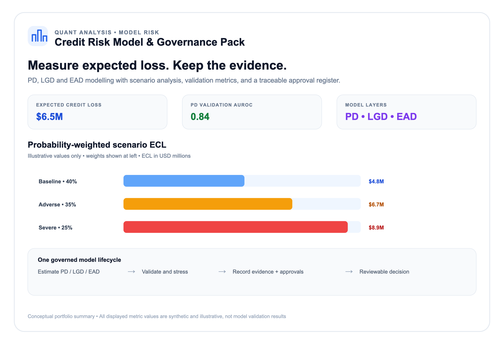
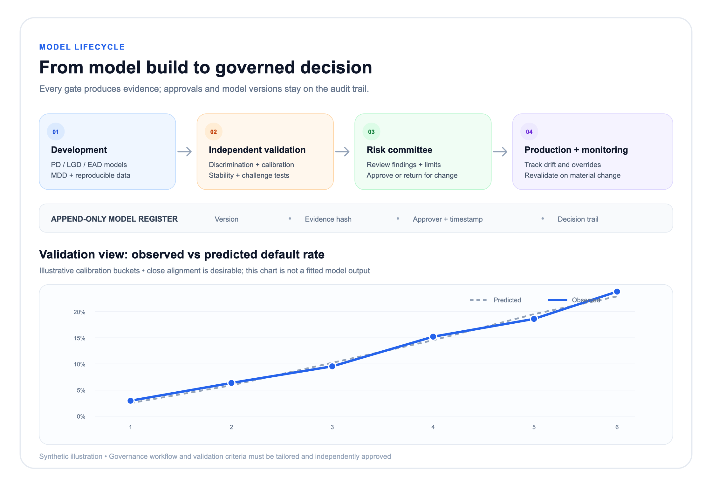
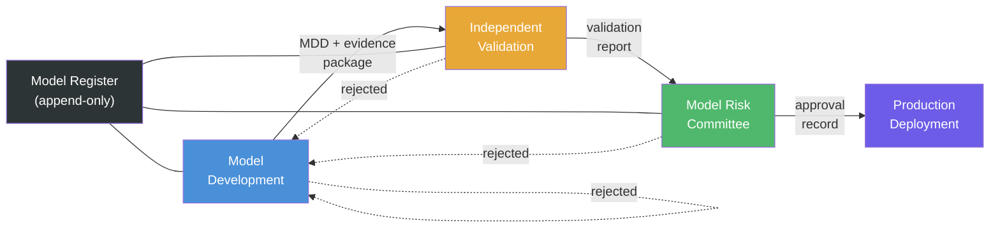

# Credit Risk Model & Governance Pack

**Credit risk modelling toolkit with embedded model governance and documentation.**

A prototype framework for building, validating and governing credit risk
models (PD, LGD, EAD) under IFRS 9 and Basel III/IV. Ships with model
documentation templates, validation checklists and a governance workflow that
maps to regulatory expectations — so the model, its evidence trail and its
approval record live in one place.

```python
from creditrisk.models import ProbabilityOfDefault, LossGivenDefault, ExposureAtDefault
from creditrisk.portfolio import Portfolio
from creditrisk.governance.register import ModelRegister
from creditrisk.validation.metrics import validate_pd_model

pd_model = ProbabilityOfDefault()
result = pd_model.fit(features, default_flag="default_12m")
print(result.summary())
# ─────────────────────────────────────
#   AUROC          0.842
#   Brier Score    0.073
#   H-L p-value    0.31   ← not rejected
# ─────────────────────────────────────

lgd_model = LossGivenDefault()
lgd_result = lgd_model.fit(features, lgd_column="lgd")

ead_model = ExposureAtDefault(method="simple")
ead_result = ead_model.fit(features, drawn_column="drawn",
                           limit_column="limit",
                           drawn_at_default_column="drawn_at_default")

portfolio = Portfolio(pd_model, lgd_model, ead_model)
el = portfolio.expected_loss(features, confidence=0.999)

register = ModelRegister()
register.register_version("PD_SME_v3", "3.2.1", "Q3 recalibration", "v3_data")
register.log_approval("PD_SME_v3", "3.2.1", "development", "Model Risk", "evidence")
```

---

## What's in the pack

| Component | Description |
|---|---|
| **PD Models** | Logistic regression, survival analysis and machine-learning estimators with calibration diagnostics |
| **LGD Models** | Beta regression, Tobit and waterfall approaches with downturn adjustments |
| **EAD Models** | CCF estimation, LEQ factor models and utilisation-at-default modelling |
| **Macro Overlay** | IFRS 9 scenario engine — baseline, adverse and severe projections with SICR triggers |
| **Validation Suite** | Discrimination (AUROC, Gini), calibration (Hosmer-Lemeshow, binomial test), stability (PSI, CSI) |
| **Model Governance** | Versioned model register, approval workflow, validation report generator, audit trail |
| **Documentation** | Model development document (MDD) template, validation report template, annual review checklist |

## Project screenshots

The white-background screenshots below pair a project overview with a
probability-weighted scenario chart, and a governance workflow with an
illustrative observed-versus-predicted calibration chart. All displayed
scenario and validation figures are synthetic visual examples, not outputs
from a fitted model or regulatory conclusions.





Scalable SVG sources are also included in `reports/`.

## Quickstart

```bash
git clone https://github.com/example/credit-risk-pack
cd credit-risk-pack
pip install -e ".[dev]"
make test
```

```python
# Fit a PD model with IFRS 9 staging
from creditrisk import ProbabilityOfDefault

pd = ProbabilityOfDefault(method="logistic")
pd.fit(
    features="data/financials.parquet",
    default_flag="default_12m",
    weights="exposure",
)
pd.calibration_report().summary()
# ─────────────────────────────────────
#  AUROC         0.842
#  Brier Score   0.073
#  H-L p-value   0.31   ← not rejected
# ─────────────────────────────────────
```

## Model governance workflow



Three lines of defence, each gated by an approval recorded in the immutable
model register. A rejection at any stage returns the model to development.
The register is the single source of truth for audit — every decision is
timestamped, hashed and attributed.

## What this proves

- **Credit risk modelling depth** — PD, LGD, EAD estimation with the statistical rigour a model validation team expects.
- **Regulatory awareness** — IFRS 9 staging, downturn calibration, macro overlays and SICR triggers built in, not bolted on.
- **Governance thinking** — The model is the product, but the evidence trail is the deliverable. Validation reports and approval workflows are first-class outputs, not afterthoughts.

## Why it matters

Credit risk models sit inside the most regulated corner of the bank. A model
that produces the right number but can't show its working is a model that gets
decommissioned. This pack treats governance as a feature — the documentation
and the validation evidence are generated alongside the model, not written six
months later from memory.

## Tech stack

| Layer | Choices |
|---|---|
| **Language** | Python 3.11 |
| **Modelling** | scikit-learn, statsmodels, lifelines, xgboost |
| **Data** | pandas, polars, PyArrow (Parquet) |
| **Validation** | pytest, great_expectations |
| **Governance** | SQLite (model register), Jinja2 (templates) |
| **Docs** | MkDocs Material, Jupyter Book |
| **CI** | GitHub Actions, pre-commit |

## Who cares

- Model risk management and model validation teams
- Credit risk analytics and portfolio management
- Regulatory reporting (IFRS 9, CECL, Basel)
- Internal audit reviewing model governance
- Fintechs building their first credit risk function

## Project status

**Alpha.** Core PD/LGD/EAD models, IFRS 9 scenario engine, validation suite
and governance register are implemented. Next: MDD template generator and
Jinja2-based report rendering.
