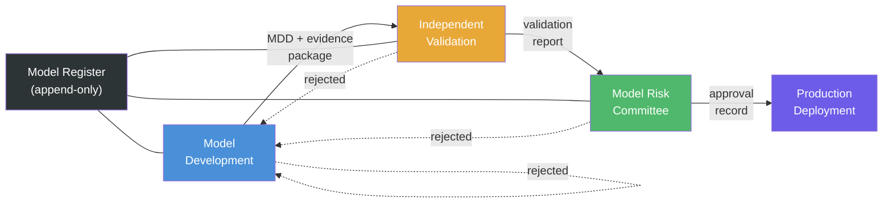

# Architecture

## System overview

The Credit Risk Model & Governance Pack is organised around four layers that
mirror how a bank's model risk function operates:

```
┌─────────────────────────────────────────────────────────────┐
│                     Portfolio Layer                          │
│  portfolio.py: aggregates PD/LGD/EAD into expected loss     │
└────────────────────┬────────────────────────────────────────┘
                     │
┌────────────────────▼────────────────────────────────────────┐
│                     Model Layer                              │
│  models/pd.py   — Probability of Default (logistic)         │
│  models/lgd.py  — Loss Given Default (beta regression)      │
│  models/ead.py  — Exposure at Default (CCF/LEQ)            │
└────────────────────┬────────────────────────────────────────┘
                     │
┌────────────────────▼────────────────────────────────────────┐
│                   Scenario Layer                             │
│  scenarios/macro.py — IFRS 9 macro overlay, SICR triggers   │
└────────────────────┬────────────────────────────────────────┘
                     │
┌────────────────────▼────────────────────────────────────────┐
│                 Governance Layer                             │
│  governance/register.py — model register, approval workflow │
│  validation/metrics.py  — discrimination, calibration, PSI  │
└─────────────────────────────────────────────────────────────┘
```

## Model governance workflow



Three lines of defence, each gated by an approval recorded in the immutable
model register. A rejection at any stage returns the model to development.
The register is the single source of truth for audit — every decision is
timestamped, hashed and attributed.

## Design decisions

### Immutable register, not a mutable database

The model register uses append-only semantics. Records are never updated or
deleted — corrections are new records that supersede earlier ones. This is
not a performance optimisation; it is a regulatory expectation. Internal
audit needs to see what was approved, when, by whom, and what changed
afterwards.

### Separate estimation from governance

The model layer (PD/LGD/EAD) has no knowledge of the governance layer.
A model can be fitted and validated without a register. The governance
module wraps the model, recording its outputs and approvals without
coupling to the estimation logic. This means you can swap the PD model
from logistic regression to XGBoost and the governance layer does not
change.

### PSI and CSI as leading indicators

The Population Stability Index (PSI) on model scores tells you the
score distribution has shifted. The Characteristic Stability Index (CSI)
on input features tells you *which* feature shifted and whether the shift
is large enough to explain the score drift. Running both gives a model
validation team a diagnosis, not just a red flag.

## Data flow

```
Raw data (Parquet) → Feature engineering → PD/LGD/EAD estimation
                                              │
                    ┌─────────────────────────┘
                    ▼
            Macro scenarios (baseline/adverse/severe)
                    │
                    ▼
            PD adjustment per scenario
                    │
                    ▼
            Probability-weighted ECL
                    │
                    ▼
            Portfolio report + validation metrics
                    │
                    ▼
            Model register (approval log)
```

## Extension points

- **Challenger models**: Swap the PD estimator to XGBoost via the shared
  `ProbabilityOfDefault` interface. The validation suite and governance
  layer consume the same `PDResult` dataclass.
- **Vendor scenarios**: Replace `generate_scenario_frame` with a feed
  from Moody's or Oxford Economics. The `MacroScenarioEngine` accepts any
  `ScenarioPath` list.
- **Multi-region**: Add jurisdiction-specific calendars, regulatory
  thresholds and reporting templates as configuration, not code.
